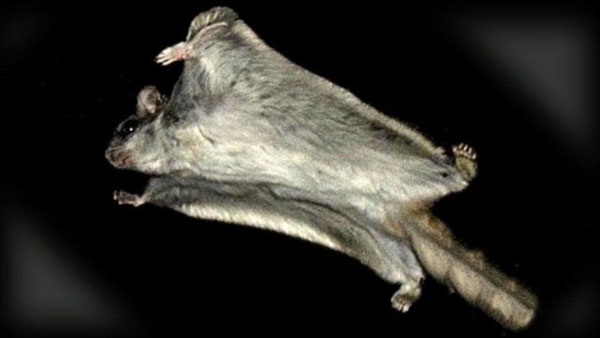

# AirMouse :mouse2:

AirMouse is developed as part of the project component of the **Mobile Systems** course at **AGH University of Krakow**.

  
  
  
  
  

  
  
  

## Goal

The goal of the project is to turn an iOS or Android phone into an air mouse – a pointing device controlled by moving the phone in the air – allowing the user to control a computer without a physical mouse or touchpad.

## Description

AirMouse uses the phone's gyroscope and accelerometer to track its orientation and movement, which are then translated into cursor movement on the computer screen. The phone also acts as an input surface for touch gestures and recognizes motion gestures performed with the device itself.

The key design assumption is that as much logic as possible runs in the mobile app: sensor data processing, cursor movement calculation, gesture recognition and mapping gestures to specific actions. The desktop app is intentionally kept minimal – it only receives ready-made commands (movement, click, scroll, system action) and executes them. This keeps the desktop app simple and makes it possible to support other operating systems or a Bluetooth HID mode without rewriting the core logic.

We also want to enrich the app with cool gesture-based features and haptic feedback to make it more fun and more useful in everyday use, especially during events such as stand-ups, daily meetings or presentations.

  

## Project variants

### Variant minimum

- Mobile app for iOS and Android
- Desktop app for macOS
- Connection between the phone and the computer over Wi-Fi
- Cursor control based on gyroscope and accelerometer data
- Clicks and scrolling
- Calibration of the reference position, preferably performed with a gesture
- Gesture support:
  - flipping the phone,
  - shaking the phone,
  - 1-, 2- and 3-finger swipes on the screen
- Gesture for switching slides during presentations
- Haptic feedback (vibration) confirming actions

The exact assignment of actions to individual gestures, including the calibration gesture, has not been decided yet and will be specified during development.

### Variant extended

- Bluetooth HID mode (Android only) – the phone is recognized as a standard Bluetooth mouse, so no software needs to be installed on the controlled device. This allows controlling Windows computers, tablets, TVs and other devices supporting Bluetooth mice.

This mode is not available on iOS, as Apple does not allow third-party apps to use the Bluetooth HID profile.

## Technical Stack

### Mobile app

- **React Native** with **Expo** (development build)
- **TypeScript** – UI and the core logic (sensor processing, cursor movement, gesture recognition), shared between iOS and Android
- **Kotlin** – native module for the Bluetooth HID mode (Android, variant extended)

Libraries selected after quick research:

- `expo-sensors` – access to gyroscope, accelerometer and fused device motion data
- `react-native-gesture-handler` – touch gestures, including multi-finger swipes
- `expo-haptics` – haptic feedback
- `react-native-udp` – UDP communication with the desktop app
- `react-native-zeroconf` – automatic discovery of the desktop app in the local network (Bonjour/mDNS)
- `react-native-reanimated` – optional, for running sensor processing off the main JavaScript thread if needed

### Desktop App

- Target platform: **macOS**
- Planned language: **Go** – the final choice of technology will be confirmed during development

Libraries selected after quick research:

- `robotgo` – cursor movement, clicks, scrolling and keyboard shortcuts on macOS
- `zeroconf` (`grandcat/zeroconf` or its maintained fork `libp2p/zeroconf`) – advertising the desktop app in the local network (Bonjour/mDNS)
- Go standard library (`net`) – UDP communication

The list of libraries for both apps may change during development.

The desktop app code will be either part of this repository or kept in a separate repository. If a separate repository is created, a link to it will be added here.

### Communication

- Transport: **UDP** over a local Wi-Fi network
- The message format and the details of the communication protocol have not been decided yet and will be described here once established.

## Team :technologist::technologist:

- [@Stanisław Barycki](https://github.com/Jeremylaby)
- [@Krzysztof Swędzioł](https://github.com/KrzysztofSwedziol/KrzysztofSwedziol)

---

_This README will be updated as the project evolves and open decisions are made._
